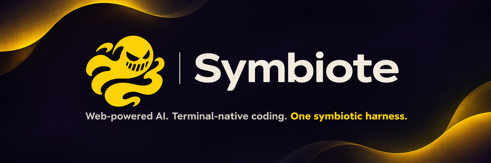

<h1 align="center"> Symbiote</h1>

<p align="center"><strong>Web-powered AI. Terminal-native coding. One symbiotic harness.</strong></p>

<p align="center">An experimental terminal coding harness that brings conversational AI services into your local development environment.</p>

<p align="center"></p>
---

## Overview

Symbiote connects web-based AI services like ChatGPT and Gemini to a local coding-agent harness, allowing you to work with AI directly from your terminal.

It combines unofficial web-session adapters with [Pi](https://github.com/earendil-works/pi), giving conversational AI access to your local codebase through a unified terminal interface.

## Project Structure

```
symbiote/
├── ai-service/       # ChatGPT and Gemini adapters
├── harness/          # Pi source and Symbiote provider extension
├── docs/             # Documentation and setup guides
├── public/           # Branding and visual assets
├── requirements.txt  # Python dependencies
├── .env.example      # Environment configuration template
└── symbiote.ps1      # Windows launcher
```

## Getting Started

### Requirements

- Windows
- Python 3.10+
- Node.js 22.19+
- Git

### 1. Install Python dependencies

From the project root:

```powershell
python -m pip install -r requirements.txt
```

### 2. Build the harness

Navigate to the harness directory:

```powershell
cd harness
npm install --ignore-scripts
npm run build:offline
cd ..
```

This builds the bundled Pi runtime without executing dependency installation scripts.

### 3. Configure an AI provider

Symbiote currently supports two experimental web-session adapters.

**ChatGPT**

Run the setup script:

```powershell
python ai-service/chatgpt/chatgpt_setup.py
```

Alternatively, configure the required values manually using `.env.example`.

The ChatGPT adapter also requires the ignored `.vendor/chatgpt-web` files. If they are not present, obtain them from the [upstream project](https://github.com/tritao/chatgpt-web):

```powershell
git clone https://github.com/tritao/chatgpt-web.git .vendor/chatgpt-web
```

**Gemini**

Configure the required Gemini session credentials in the root `.env` file.

Refer to the [Gemini setup guide](docs/gemini.md) for details.

### 4. Launch Symbiote

Navigate to the directory of the codebase you want to work on and run:

```powershell
powershell -ExecutionPolicy Bypass -File "C:\path\to\symbiote\symbiote.ps1"
```

To use Gemini instead of the default provider:

```powershell
powershell -ExecutionPolicy Bypass -File "C:\path\to\symbiote\symbiote.ps1" -Provider gemini
```

Replace the script path with your actual Symbiote installation location.

## How It Works

Symbiote bridges conversational AI services with a local coding-agent runtime.

- **AI Service Adapters:** Connect to ChatGPT and Gemini through authenticated web sessions.
- **Provider Bridge:** Translates conversations and tool interactions into a text-based protocol supported by the adapters.
- **Coding Harness:** Uses Pi's tools to inspect and modify files and execute terminal commands.
- **Local Execution:** Works within the project directory from which Symbiote is launched.

## Limitations & Security

Symbiote is experimental and relies on unofficial web-session interfaces.

- Provider sessions can expire, require verification, or stop working when websites change.
- The adapters currently support text-based interactions only; image input is not supported.
- Tool calls and responses may fail when provider interfaces or model output formats change.
- Gemini requires valid session credentials and may require additional verification.
- The provider bridge forwards Pi conversations, including tool results, to the selected web service.
- Pi can modify files and execute commands. Review its configuration and permissions before use.

**Security:** Treat session cookies, authentication headers, and `.env` files as private account credentials. Never commit them to version control or share them publicly.

## Project Status

Symbiote is under active development. Provider integrations, harness orchestration, and setup workflows are experimental and may change.

## Credits

Symbiote builds on [Pi](https://github.com/earendil-works/pi), the extensible coding-agent harness created by Mario Zechner and contributors.

Pi is distributed under the [MIT License](https://github.com/earendil-works/pi/blob/main/LICENSE).

---

<p align="center"><strong>Symbiote</strong><br/><sub>One interface. Multiple minds. Your terminal.</sub></p>
